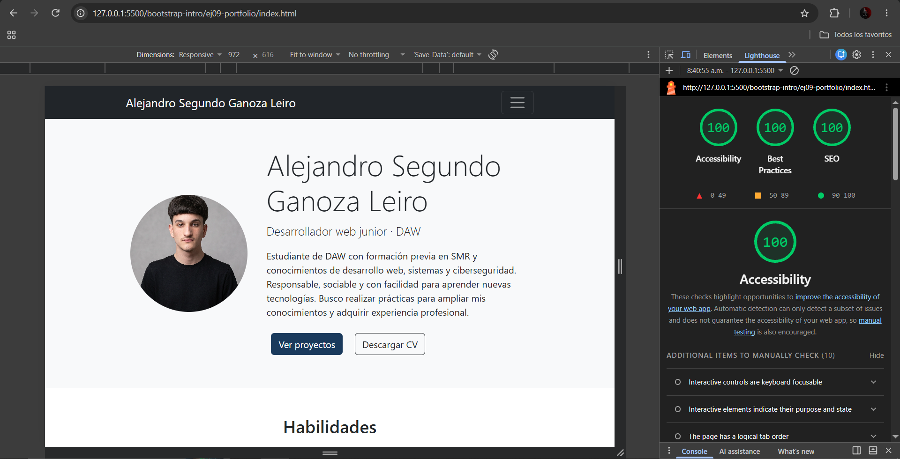
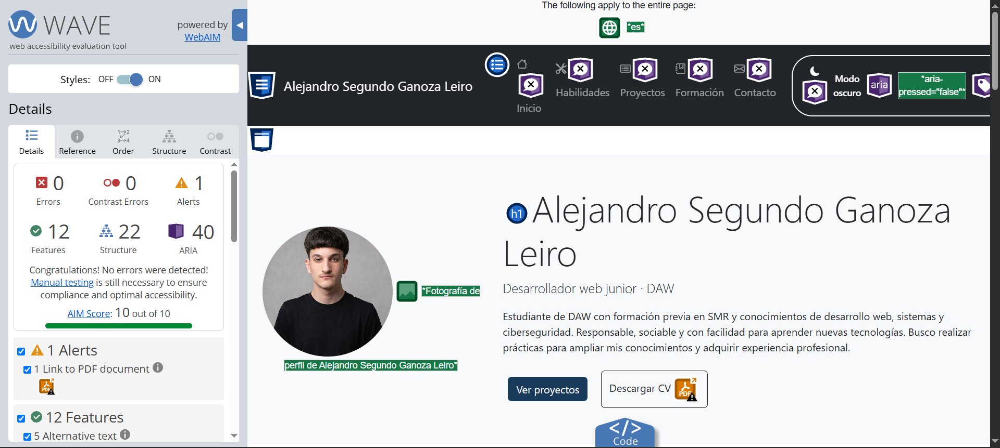
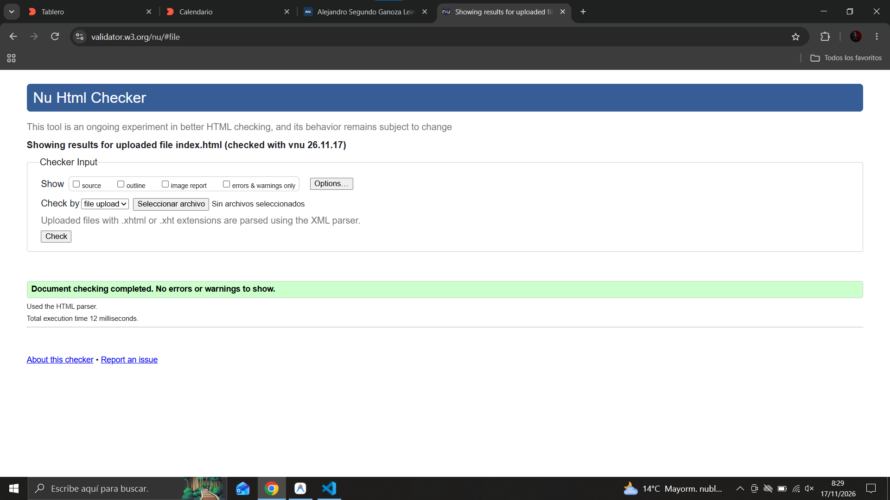
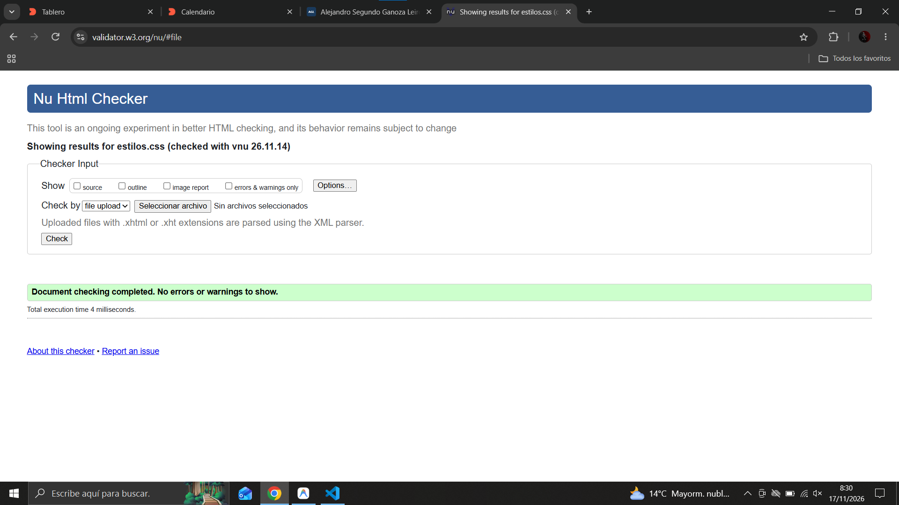

# Portfolio Personal – Alejandro Segundo Ganoza Leiro

Portfolio web profesional desarrollado a lo largo de las unidades **UD6** (Estructura, contenido y maquetación con Bootstrap) y **UD7** (Marca personal, accesibilidad, calidad y entrega final) para el ciclo formativo de **Desarrollo de Aplicaciones Web (DAW)**.

- **URL de la web publicada:** [https://agl0073.github.io/bootstrap-intro-alumnos-1/bootstrap-intro/ej09-portfolio/index.html](https://agl0073.github.io/bootstrap-intro-alumnos-1/bootstrap-intro/ej09-portfolio/index.html)
- **URL del repositorio público:** [https://github.com/agl0073/bootstrap-intro-alumnos-1](https://github.com/agl0073/bootstrap-intro-alumnos-1)
- **Tecnologías utilizadas:** HTML5 semántico, CSS3 personalizado (`css/estilos.css`), JavaScript nativo (`js/main.js`), Framework Bootstrap 5.3 (vía CDN) y Bootstrap Icons.

---

## 📌 Evolución del proyecto: Entrega 1 (UD6) y Entrega 2 (UD7)

### Fase 1: Estructura semántica y maquetación (UD6)
En la primera fase se estableció la base estructural del sitio empleando únicamente HTML5 semántico y utilidades nativas de Bootstrap 5.3:
- **Barra de navegación:** Responsive con colapso tipo hamburguesa y fijación superior (`sticky-top`).
- **Sección Portada / Sobre mí:** Presentación personal, fotografía de perfil y llamada a la acción con enlaces directos a proyectos y currículum.
- **Sección Habilidades:** Cuadrícula de tarjetas responsivas (`row-cols-*`) clasificadas en áreas técnicas (Front-end, Back-end, Bases de datos, Herramientas, Idiomas y Competencias transversales) usando badges temáticos.
- **Sección Proyectos:** Tarjetas informativas con proyectos reales vinculados a repositorios de GitHub con capturas representativas.
- **Sección Formación y experiencia:** Componente tipo Acordeón (`accordion`) de Bootstrap para desglosar estudios y prácticas profesionales.
- **Sección Contacto:** Formulario maquetado con campos obligatorios y enlaces a perfiles sociales (LinkedIn, GitHub y correo electrónico).
- **Pie de página:** Cierre semántico institucional accesible.

### Fase 2: Marca personal, accesibilidad, JS y calidad (UD7)
En esta entrega final se enriqueció el proyecto con identidad propia, componentes dinámicos e interactivos y máxima accesibilidad:
- **Componentes JavaScript interactivos:**
  - *Modal de proyectos:* Ventana emergente interactiva que carga dinámicamente imagen a gran tamaño, resumen técnico, badges de tecnologías y enlace directo a GitHub según el proyecto seleccionado.
  - *Modo Claro / Oscuro:* Botón conmutador accesible integrado en la barra de navegación que cambia el atributo `data-bs-theme` y recuerda la preferencia del usuario en `localStorage`.
- **Formulario validado:** Integración de la validación nativa de Bootstrap (`needs-validation` y `was-validated`) con retroalimentación visual accesible (`invalid-feedback`), atributos `autocomplete` y mensaje de confirmación tras el envío.
- **Estilos de marca propios (`css/estilos.css`):** Definición de variables CSS (`:root`), paleta de color propia, navegación por foco visible y eliminación total de estilos en línea.
- **Optimización de recursos:** Inclusión de favicon vectorial SVG con monograma propio (`img/favicon.svg`), metadatos SEO y optimización de todas las imágenes a un peso inferior a 300 KB.

---

## 🎨 Paleta de colores y ratios de contraste (WCAG 2.1 AA)

La identidad visual se ha diseñado respetando rigurosamente los criterios de accesibilidad **WCAG 2.1 nivel AA** (mínimo 4.5:1 en texto normal y 3:1 en texto grande/componentes), verificados con WebAIM Contrast Checker:

| Color / Variable | Código Hex | Uso principal | Combinación probada | Ratio de Contraste | Cumplimiento |
|---|---|---|---|---|---|
| `--bs-primary` (modo claro) | `#1a3a5c` | Azul corporativo: enlaces, títulos, botones | Texto `#1a3a5c` sobre fondo `#ffffff` | **10,5:1** | Cumple AAA (supera 4.5:1) |
| Blanco | `#ffffff` | Texto en botones y tarjetas | Texto `#ffffff` sobre botón `#1a3a5c` | **10,5:1** | Cumple AAA |
| `--color-acento` | `#2a7a4b` | Verde acento: estados hover y destacados | Texto `#2a7a4b` sobre fondo `#ffffff` | **5,1:1** | Cumple AA |
| `--color-foco` | `#fd7e14` | Naranja accesible: indicador `:focus-visible` | Borde `#fd7e14` sobre fondo `#ffffff` | **3,1:1** | Cumple foco (≥ 3:1) |
| `--bs-primary` (modo oscuro) | `#90bce8` | Azul claro: enlaces y botones en oscuro | Texto `#90bce8` sobre fondo `#121820` | **9,2:1** | Cumple AAA |
| Texto modo oscuro | `#e8f1fa` | Texto principal sobre fondo de tarjetas | Texto `#e8f1fa` sobre `#1e2a38` | **12,8:1** | Cumple AAA |
| Texto secundario | `#495057` | Párrafos secundarios y detalles | Texto `#495057` sobre `#f8f9fa` | **6,4:1** | Cumple AA |

---

## ♿ Accesibilidad y buenas prácticas

1. **Navegación por teclado y foco:**
   - Enlace inicial «Saltar al contenido» (`visually-hidden-focusable`) que lleva el foco directamente a `<main id="contenido-principal">`.
   - Indicador de foco visible (`:focus-visible`) resaltado con contorno de `3px` sin anular el outline del navegador.
2. **Semántica y soporte para lectores de pantalla:**
   - Todas las imágenes disponen de atributo `alt` descriptivo.
   - Iconos decorativos acompañados de `aria-hidden="true"`.
   - Botones y enlaces basados únicamente en iconos (o sin texto explícito) cuentan con `aria-label` descriptivos.
   - Textos de enlace claros y contextuales (sin fórmulas genéricas como "pincha aquí").
3. **Respeto a preferencias de usuario:**
   - Regla `@media (prefers-reduced-motion: reduce)` implementada para desactivar transiciones o scroll suave en usuarios con sensibilidad al movimiento.
4. **Optimización técnica:**
   - Enlaces externos asegurados con `target="_blank"` y `rel="noopener"`.
   - Todas las imágenes son responsivas (`img-fluid`) y pesan menos de 300 KB (`CV_Original.jpg` optimizada a ~128 KB).
   - Enlace directo al currículum en PDF en `docs/CV.pdf`.
   - Consola del navegador 100% limpia de errores y advertencias.

---

## 📊 Informe de calidad y auditorías

Se han ejecutado las pruebas de validación requeridas para garantizar la robustez técnica del proyecto:

### 1. Lighthouse (Chrome DevTools - Modo Móvil)
- **Accesibilidad:** 100 / 100
- **Buenas Prácticas:** 100 / 100
- **SEO:** 100 / 100

---

### 2. WAVE Web Accessibility Evaluation Tool
- **0 errores** de accesibilidad.
- **0 errores** de contraste.

---

### 3. Validador HTML del W3C
- **0 errores** de sintaxis y marcado semántico.

---

### 4. Validador CSS del W3C
- **0 errores** en la hoja de estilos personalizada `css/estilos.css`.

---

## 🤖 Declaración de uso de Inteligencia Artificial

- **Redacción de documentación (README.md):** El presente documento ha sido generado en su totalidad con la asistencia de Inteligencia Artificial para estructurar, organizar y sintetizar detalladamente todas las fases y evidencias del proyecto.
- **Desarrollo de estilos y scripts (`css/estilos.css` y `js/main.js`):** Se ha utilizado la IA como apoyo y soporte técnico para la codificación, depuración de funciones interactivas.

